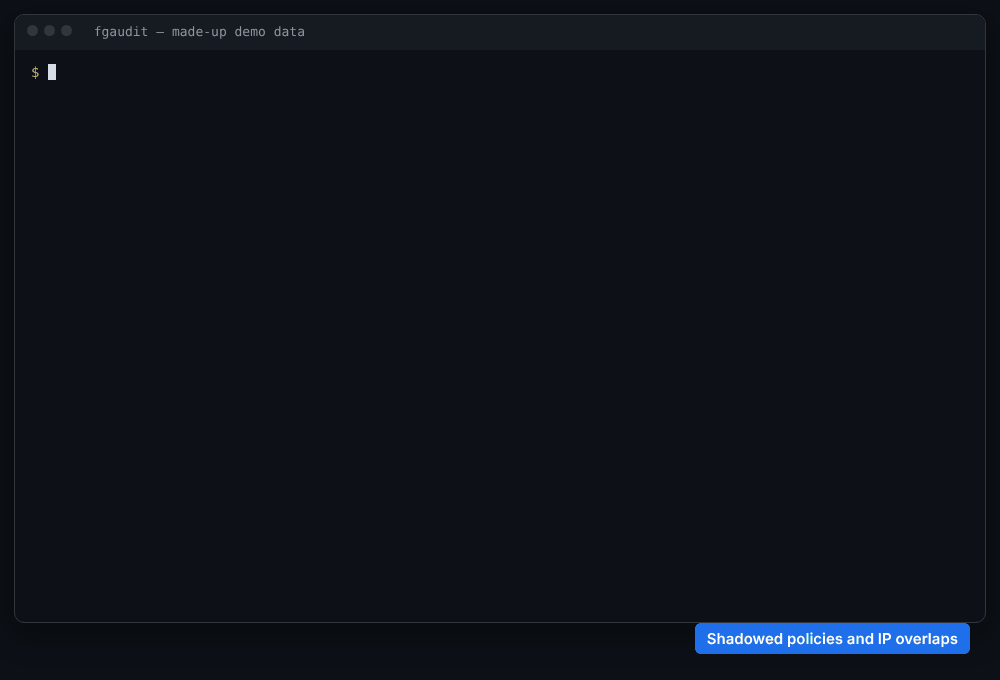
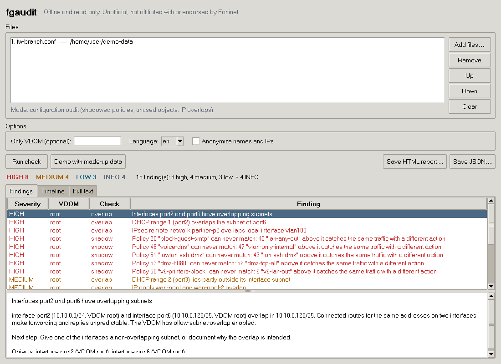
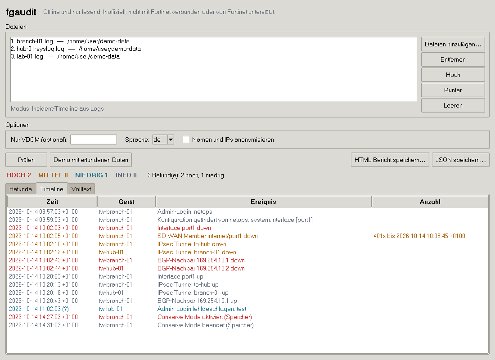
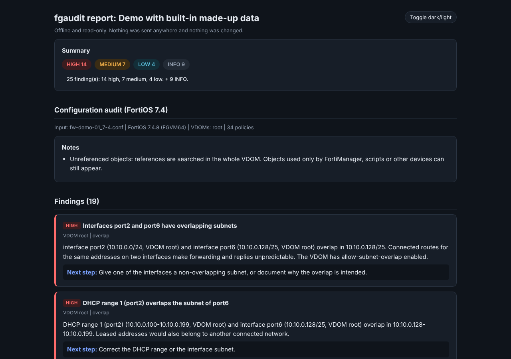
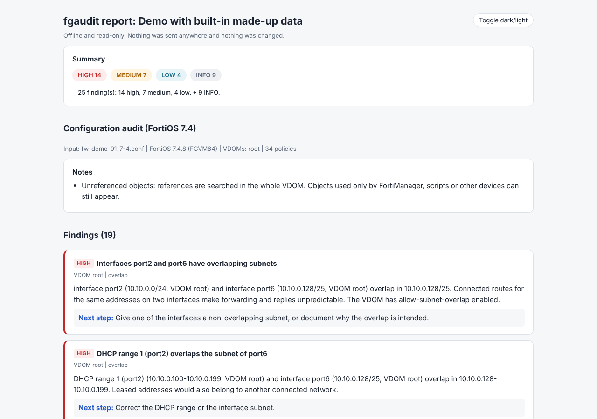

# fgaudit

**Offline checks for FortiGate config backups and logs, explained in plain language.**

Give it one backup, two backups or a few log files. fgaudit finds out what you gave it and tells
you what is wrong, why it matters, and what to do next:

| You run | You get |
|---|---|
| `fgaudit backup.conf` | Shadowed and redundant policies, unused objects, overlapping IP ranges |
| `fgaudit before.conf after.conf` | The risk of a change: lockout, broad rules, routing/VPN/HA/NAT, moved policies |
| `fgaudit fw1.log fw2.log` | An incident timeline with a likely trigger and the chain of follow-up events |
| `fgaudit --demo` | All of the above on built-in, made-up data |
| `fgaudit-gui` | The same checks in a window, for people who prefer not to use the command line |

> **Unofficial, not affiliated with or endorsed by Fortinet.** FortiGate, FortiOS, FortiManager
> and FortiAnalyzer are trademarks of Fortinet, Inc. They are used here only to say what this tool
> reads.



It is strictly **offline and read-only**. It never connects to a firewall, has no API client, sends
no telemetry, and never changes an input file. It has no dependencies beyond the Python standard
library.

## Install

Python 3.10 or newer on Windows, Linux or macOS.

```bash
pip install fgaudit          # once it is published on PyPI
# or, from a checkout of this repository:
pip install .
```

Then:

```bash
fgaudit --demo               # try it without any real data
fgaudit backup.conf
```

New to Python on Windows? See [docs/WINDOWS.md](docs/WINDOWS.md) (in German).

## Window (GUI)

```bash
fgaudit-gui          # or: fgaudit --gui   or: python -m fgaudit.gui
```

The window runs exactly the same checks as the command line, with the same secret redaction,
anonymization and error handling. Add files, see which mode they will run in (and swap before and
after for a change review), set the VDOM, language and anonymization, and click **Run check** or
**Demo with made-up data**. Findings are listed by severity with their details and next step; logs
also get a timeline tab. **Save HTML report** and **Save JSON** write the same reports as `--html` and
`--json`. Files given on the command line are preloaded: `fgaudit-gui backup.conf`.

| Findings | Timeline (German) |
|---|---|
|  |  |

The window uses tkinter from the Python standard library, so there is still nothing extra to install.
The python.org installers for Windows and macOS include it. On Linux it may be a separate package
(`sudo apt install python3-tk` on Debian/Ubuntu, `sudo dnf install python3-tkinter` on Fedora). The
command line works without it.

## Usage

```text
fgaudit FILE [FILE ...] [--vdom NAME] [--html report.html] [--json] [--anonymize] [--lang de]
fgaudit --gui [FILE ...]
```

| Option | Effect |
|---|---|
| `--vdom NAME` | Only check this VDOM. Without it, every VDOM is checked separately. |
| `--html FILE` | Also write a self-contained HTML report (offline, dark and light mode, no scripts). |
| `--json` | Print JSON instead of text. Redirect it: `fgaudit a.conf --json > report.json`. Format: [docs/json-schema.md](docs/json-schema.md). |
| `--anonymize` | Replace IP addresses, host names, user names and object names consistently. |
| `--lang de` | German output. Default is English. `FGAUDIT_LANG=de` does the same. |
| `--gui` | Open the window instead (same as `fgaudit-gui`). |

The mode comes from the input: one config means an audit, two configs mean a change review (first
is *before*, second is *after*), and log files mean a timeline. Wildcards such as `*.log` work on
Windows too.

**Exit codes:** `0` no findings (info notes do not count), `1` findings, `2` error (unreadable
input, encrypted backup, wrong file type). `--demo` always exits `0`.

### Sample output

Shortened, from `fgaudit --demo`:

```text
SUMMARY
  [HIGH] 8  [MEDIUM] 4  [LOW] 3  [INFO] 4
  15 finding(s): 8 high, 4 medium, 3 low. + 4 INFO.

FINDINGS

  [HIGH] Policy 20 "block-guest-smtp" can never match: 40 "lan-any-out" above it catches the same
         traffic with a different action
         VDOM root | shadow
         Policy 40 "lan-any-out" (action accept) fully covers policy 20 "block-guest-smtp" (action
         deny) in every match criterion: interfaces, source, destination, service, schedule, users.
         Traffic meant for 20 "block-guest-smtp" gets action accept instead. Note: policy 40 has the
         higher ID but sits higher in the list (position 15 before 16). Order counts, not the ID.
         -> Next step: Decide which action is intended. If the later policy should apply, move it above
            the earlier one. Check the hit count and last-used time of both policies on the FortiGate
            (Policy & Objects > Firewall Policy) before you change or delete anything.

  [INFO] Not reliably checkable: policy 43 "dmz-partner" may be shadowed by 7 "updates"
         VDOM root | shadow
         7 "updates" covers 43 "dmz-partner" in every criterion that can be checked statically. For
         destination this cannot be proven because dynamic or unresolvable objects are involved
         (partner-fqdn). fgaudit therefore does not report shadowing.
```

```text
TIMELINE
     2026-10-14 09:59:03 +0100  fw-branch-01 Config changed by netops: system.interface [port1]
  !! 2026-10-14 10:02:03 +0100  fw-branch-01 Interface port1 down
  !  2026-10-14 10:02:05 +0100  fw-branch-01 SD-WAN member internet/port1 down  401x until 2026-10-14 10:08:45 +0100
  !  2026-10-14 10:02:10 +0100  fw-branch-01 IPsec tunnel to-hub down
  !  2026-10-14 10:02:12 +0100  fw-hub-01    IPsec tunnel branch-01 down
  !! 2026-10-14 10:02:43 +0100  fw-branch-01 BGP neighbor 169.254.10.1 down
```

The full demo report: [docs/sample-report.html](docs/sample-report.html) (download and open it) and
[docs/sample-report.json](docs/sample-report.json).

| Dark | Light |
|---|---|
|  |  |

The terminal output uses colour only on a real terminal. Each severity is also written as a tag
(`[HIGH]`, `[MEDIUM]` …), so the output stays readable without colour, in logs and in screen
readers. `NO_COLOR` and `FORCE_COLOR` are respected.

## Supported FortiOS versions

| Version | Status |
|---|---|
| 7.4, 7.6, 8.0 | Supported. Checked against the official CLI and Log References (see [Sources](#sources)). |
| Anything else | A clear warning, then the checks run anyway. Results may miss version-specific fields. |

The version comes from the `#config-version=` header of the backup. Logs carry no version, so the
timeline uses the log IDs that appear in the Log References of all three versions.

VDOMs are detected automatically. Each VDOM is checked on its own, and configs without VDOMs work
the same way (as one VDOM named `root`).

## What it checks, and how

### 1. Shadowed policies

For every VDOM, policies are evaluated **in the order they appear in the config file**, which is
the order the FortiGate uses. Policy IDs do not matter for this. A later policy is reported only if
**one single, enabled, earlier policy** covers it completely in every match dimension:

- incoming and outgoing interfaces (zones and SD-WAN zones are expanded, `any` covers all),
- source and destination addresses, IPv4 and IPv6 separately (groups are resolved recursively,
  including `exclude-member`; `srcaddr-negate` and friends invert the set),
- services: protocol, destination port ranges **and** source port ranges, ICMP type and code,
  service groups,
- schedule (`always` covers everything; two different named schedules are not compared),
- users and groups (a policy without users covers one with users, not the other way round),
- plus restricting options such as ZTNA tags, `vpntunnel` or `policy-expiry`, which make a policy
  narrower than its address fields suggest.

Partial overlap is **not** shadowing. If two policies only overlap, nothing is reported.

The result has four types:

| Finding | Severity | Meaning |
|---|---|---|
| Shadowed, different action | high | The later policy never matches, and its traffic gets the other action. |
| Redundant, same action | medium if security profiles differ, else low | The later policy never matches. Profile differences are listed. |
| Duplicate | low | Identical match criteria and action. |
| Unreferenced objects | low | Addresses, groups, services, schedules not used anywhere in the VDOM. Factory defaults are excluded. |

**Dynamic objects** (FQDN, geography, ISDB/internet services, dynamic and SDN addresses, VIPs,
interface-subnet objects, and anything that cannot be resolved) have no fixed IP range in a backup.
If the outcome depends on them, fgaudit reports **"not reliably checkable"** (info) instead of
claiming shadowing. An earlier policy with `all` does cover FQDN and geo objects, because `all`
contains every address. It never counts as covering a VIP or ISDB object, because those change how
the FortiGate matches.

fgaudit **deletes nothing and recommends nothing irreversible**. Every finding asks you to check the
hit counts and last-used times on the device before removing a policy.

### 2. Change risk (before/after)

A semantic diff, not a text diff:

- The header, UUIDs and the order of unordered lists (members, allowaccess …) are ignored. Policy
  **order** is not ignored: a moved policy is detected (longest increasing subsequence of the policy
  order) and rated by whether it now meets a policy with another action that matches the same
  traffic.
- Changed address objects, groups and services list **every affected policy**, including via
  nested groups.
- Encrypted values (`ENC …`) differ between backups even when the secret is the same, so a
  different ENC value is reported as **"not comparable"** (info) and never as a confirmed change.

Rated rules with a reason, among others:

| Area | Examples | Severity |
|---|---|---|
| Lockout | `allowaccess` loses https/ssh, admin ports change, `trusthost` narrowed, `local-in-policy`, interface IP or status change, default route change | high |
| Broad rules | new or changed accept with `all`/`ALL` in source, destination and service | high |
| Logging | `logtraffic disable` on a policy, log settings changed | medium |
| Routing, SD-WAN, HA, VPN, NAT | static routes, BGP/OSPF, SD-WAN members/rules, HA mode/priority/hbdev, phase1/phase2, VIPs and IP pools | medium to high |
| Insecure management | http/telnet added to `allowaccess` | medium |
| Everything else | a short "other change" line | low / info |

The overall change risk is the highest severity found.

### 3. Overlapping IP ranges

Compared within each VDOM (and VRF):

- interface addresses including secondary IPs and IPv6,
- DHCP server ranges (minus exclude ranges): outside their own interface subnet, or overlapping
  another interface, another DHCP range, a VIP or an IP pool,
- IP pools against each other,
- VIP external addresses (same external interface, overlapping ports for port forwards),
- IPsec phase 2 selectors against local interfaces and against each other.

To avoid false alarms, `0.0.0.0/0` selectors, the default route and more specific routes are not
reported. A remote selector that is a summary of a local network (hub-and-spoke) is not reported
either. /32 addresses on tunnel and loopback interfaces are allowed to repeat.

Overlaps between different VDOMs or VRFs are only an info hint, because they are separate routing
tables. Every finding names both objects, their VDOMs and the exact overlapping range.

### 4. Incident timeline from logs

- Reads FortiGate `key=value` logs, also with a syslog header in front, from several files and
  several devices at once.
- Sorts by `eventtime` (epoch, s/ms/µs/ns detected) and `tz`. If neither `eventtime` nor `tz` is
  present, the times are shown as device-local and marked `(?)`, with a note. fgaudit never
  guesses a time zone.
- Recognises interface up/down, SD-WAN members and health checks, IPsec tunnels and phase 1/2, HA
  state and failover, BGP and OSPF neighbours, conserve mode, reboots and shutdowns, admin logins
  (successful and failed) and config changes. Traffic and UTM logs are counted and skipped.
- Collapses repeats: 401 identical "SD-WAN member down" messages become one line with the count
  and the time range.
- Groups anomalies into incidents (separated by 30 minutes of quiet) and names the **likely trigger
  and the chain of follow-up events as a hypothesis**, with the reasoning and a confidence level
  (high, medium, low). A config change or admin login shortly before the trigger is pointed out.
- Unknown log IDs are counted and listed, never silently dropped.

### Not reliably checkable

When fgaudit cannot prove something from the file alone, it says so. "Not reliably checkable" is
an intended result, not an error. It is better than a confident false claim.

## Data safety

- **Secrets are never printed**: passwords, pre-shared keys, private keys, certificates' key
  material and every `ENC …` value. This holds for the terminal, the HTML and JSON reports, and
  error messages. Two layers make sure of that: secret fields are collected while parsing, and every
  string of the finished report is filtered again before output. Parser warnings contain line
  numbers and codes, never file content.
- **`--anonymize`** replaces IPv4 and IPv6 addresses (prefix-preserving with a random key per
  run, so subnets still line up within one report), host names, VDOM names, user names, object
  names and file names, consistently across the whole report. Generic names such as `port1`, `wan1`,
  `all` or `always` stay readable. Review the report before you share it anyway.
- **Untrusted input**: every input file is treated as untrusted. Damaged, truncated or binary files
  give a clear message and exit code 2, never a traceback. The HTML report escapes all content and
  forbids scripts with a Content Security Policy. Files over 512 MB are refused (`FGAUDIT_MAX_MB`
  changes this).
- **Encrypted backups** cannot be read. fgaudit says so and asks for a backup made without
  encryption.
- `--html` never overwrites an input file or an existing non-HTML file.

## Tests

```bash
python -m unittest discover -s tests -v
```

The tests are standard-library `unittest`, with no extra packages. They use only **synthetic** data
from `src/fgaudit/synth.py`, a generator that builds FortiOS 7.4, 7.6 and 8.0 configs (with and
without VDOMs) and logs with deliberately injected faults. They cover:

- each injected fault is found, with the right policy or object and severity,
- a clean reference config gives zero findings in every version, with and without VDOMs,
- partial coverage is not reported as shadowing,
- dynamic objects give "not reliably checkable",
- file order beats ID order,
- no false alarms for the default route, 0/0 selectors, hub-and-spoke summaries or changed ENC values,
- no secret appears in terminal, HTML or JSON output, nor in error messages,
- `--anonymize` leaves no original IP or name in the output,
- 80 random mutations of a config (truncation, binary noise, unbalanced blocks) never crash,
- a config with 5,000 policies runs in usable time,
- the window gives the same results as the command line, shows no secrets, and runs a check and the
  demo (the window test needs tkinter and a display; it is skipped otherwise).

Latest results: [docs/test-results.txt](docs/test-results.txt).

**Performance** (one CPU core, Python 3.13, see `scripts/measure_large.py`): a realistic config with
5,000 policies across 24 interfaces takes about 3.5 seconds. The worst case, 5,000
policies all on the same interface pair so that every policy is compared with every earlier one,
takes about 13 seconds.

### What has been tested only with synthetic data

Everything. The tool has not yet been run against a real FortiGate backup or real logs. The
generator follows the CLI and Log References, but real configs contain fields, defaults and log
variants that a generator cannot fully anticipate. Please open an issue (without real data) if a
real config gives a wrong result.

## Known limits

- Schedules are compared by name only (`always` covers all). Two different schedules with
  overlapping times are treated as "not covering".
- Security profiles do not affect shadowing; they are only listed as differences.
- Central NAT, policy-based NGFW mode (security policies), proxy policies, multicast, local-in
  and DoS policies are not part of the shadow check. NGFW policy mode gives a note.
- Internet Service Database (ISDB) objects, FQDNs, geography, dynamic/SDN addresses and VIPs are
  not resolved offline (see "not reliably checkable").
- Unused-object detection looks inside the VDOM. Objects used only by FortiManager, scripts,
  other devices or global settings can still be listed.
- Change review compares two backups of the same device. Comparing different devices works but
  gives many findings.
- The timeline knows the most important event log IDs. Other events are counted as unrecognised.
  The free-text `msg` wording of some events (for example BGP and OSPF) differs between builds;
  fgaudit uses the log ID first and the text only as a fallback.
- The config header format and the layout of encrypted backups are not documented in the CLI
  Reference. fgaudit recognises them heuristically.
- The window was tested on Linux under a virtual display (Xvfb) only. Its look depends on the
  operating system's theme.
- Tested on Linux with Python 3.10 and 3.13. Windows and macOS are expected to work (pure Python,
  no platform code apart from enabling colours on Windows) but were not tested.

## Project layout

```text
src/fgaudit/
  parser.py        config tokenizer and tree, reusable without the checks
  model.py         version, VDOM and file-type detection
  objects.py       address, service, interface and user resolution
  netsets.py       interval sets for IPs and ports
  checks/          shadow.py, change.py, overlap.py, timeline.py, policies.py
  logs.py          key=value log parser
  privacy.py       secret redaction and anonymization
  render.py        text, HTML and JSON output
  gui.py           tkinter window on top of the same checks
  i18n.py          English and German texts
  synth.py         synthetic config and log generator (tests and --demo)
tests/             unittest suites
scripts/           performance measurement, demo GIF builder
docs/              guides, sample report, screenshots
```

The parser can be used on its own:

```python
from fgaudit.parser import parse
tree = parse(open("backup.conf", encoding="utf-8").read()).root
for key, policy in tree.children["firewall policy"].entries.items():
    print(key, policy.get("name"), policy.get_list("srcaddr"))
```

## Sources

- FortiOS 7.4.0 CLI Reference: <https://fortinetweb.s3.amazonaws.com/docs.fortinet.com/v2/attachments/9193cdf6-ef51-11ed-8e6d-fa163e15d75b/FortiOS-7.4.0-CLI_Reference.pdf>
- FortiOS 7.6.4 CLI Reference: <https://fortinetweb.s3.amazonaws.com/docs.fortinet.com/v2/attachments/0bec1c7c-7948-11f0-9bfd-6af4c3636dc7/FortiOS-7.6.4-CLI_Reference.pdf>
- FortiOS 8.0.2 CLI Reference: <https://fortinetweb.s3.amazonaws.com/docs.fortinet.com/v2/attachments/618862e1-3462-11f1-b31d-02356ffb40d9/FortiOS-8.0.2-CLI_Reference.pdf>
- FortiOS 7.4.9 Log Reference: <https://fortinetweb.s3.amazonaws.com/docs.fortinet.com/v2/attachments/514718ad-8f65-11f0-9bfd-6af4c3636dc7/FortiOS_7.4.9_Log_Reference.pdf>
- FortiOS 7.6.4 Log Reference: <https://fortinetweb.s3.amazonaws.com/docs.fortinet.com/v2/attachments/3ac31ccf-6656-11f0-a9d0-d2b0d2e22f7d/FortiOS_7.6.4_Log_Reference.pdf>
- FortiOS 8.0.0 Log Reference: <https://fortinetweb.s3.amazonaws.com/docs.fortinet.com/v2/attachments/be09e711-381d-11f1-b31d-02356ffb40d9/FortiOS_8.0.0_Log_Reference.pdf>
- Fortinet Community, "Understanding FortiGate configuration file format": <https://community.fortinet.com/t5/FortiGate/Technical-Tip-Understanding-FortiGate-Configuration-File-Format/ta-p/373020>
- fotoobo documentation on the FortiGate config structure: <https://fotoobo.readthedocs.io/en/latest/developer/how_to/fortinet/fortigate/fortigate_config.html>

Details on what each source was used for: [docs/SOURCES.md](docs/SOURCES.md).

## License

MIT, see [LICENSE](LICENSE). Unofficial, not affiliated with or endorsed by Fortinet.
